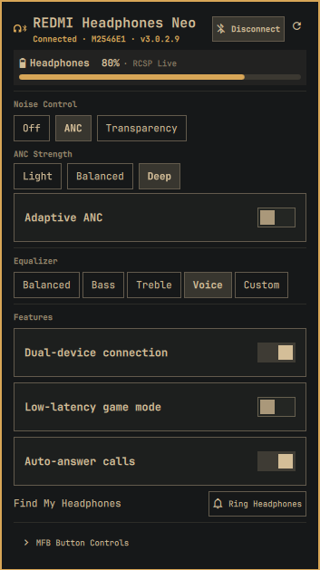

# REDMI Headphones Neo — Omarchy Shell Plugin (`0xakadev.redmi-neo`)

Full-featured Omarchy bar widget and control panel specifically built for **REDMI Headphones Neo** (`miwear.headphone.o70cg` / `M2546E1`, `VID 0x2717`, `PID 0x50F0`).



## Installation

```bash
omarchy plugin add https://github.com/0xakadev/omarchy-redmi-neo.git --enable
```

## Supported Hardware Features

- **Active Noise Cancellation (ANC)**:
  - Modes: `Off`, `ANC`, `Transparency`
  - 3 ANC Strength Levels: `Light`, `Balanced`, `Deep`
  - **Adaptive ANC** toggle
  - 3 Transparency Sub-Modes: `Regular`, `Enhance Voice`, `Ambient`
- **Battery & Telemetry**:
  - Live headset battery percentage & charging status via Xiaomi RCSP (`0x02` / `0x0E`)
  - BlueZ `org.bluez.Battery1` & `ManufacturerData` (`0xFFFF` BLE advertisement beacon) fallback — displays last advertised battery even when disconnected
  - Active Bluetooth audio codec (`AAC`, `SBC`, `SBC-XQ`) & firmware version display
- **Equalizer**:
  - Hardware EQ Presets: `Balanced`, `Bass`, `Treble`, `Voice`, `Custom`
  - **10-Band Custom Equalizer** (`62 Hz` – `16 kHz`, `-6 dB` to `+6 dB` per band) with instant 0 dB reset
- **Device Features & MFB Controls**:
  - **Dual-Device Connection** (Multipoint) toggle
  - **Low-Latency Game Mode** toggle
  - **Auto-Answer Calls** toggle
  - **Find My Headphones** audio alert (Ring / Stop)
  - **MFB Button Controls**: customize `Single press`, `Double press`, `Triple press`, `Long press`, and `Long-press ANC cycle` mask
  - One-click **Connect / Disconnect** via BlueZ D-Bus

## CLI & Hyprland Keybinding Integration

Use `bin/redmictl` or Omarchy IPC:

```bash
# Query full state JSON
~/.config/omarchy/plugins/0xakadev.redmi-neo/bin/redmictl state

# Cycle ANC modes (Off -> ANC -> Transparency)
omarchy-shell 0xakadev.redmi-neo.anc set cycle
~/.config/omarchy/plugins/0xakadev.redmi-neo/bin/redmictl anc cycle

# Set ANC strength or EQ preset
~/.config/omarchy/plugins/0xakadev.redmi-neo/bin/redmictl anc-level deep
~/.config/omarchy/plugins/0xakadev.redmi-neo/bin/redmictl eq bass
```
